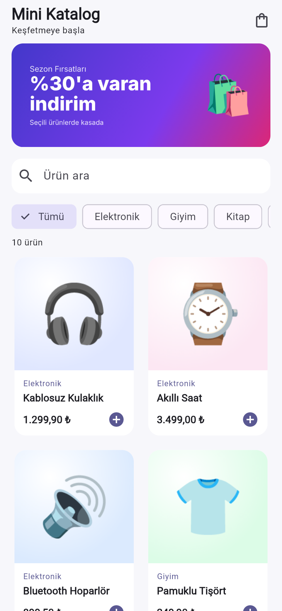
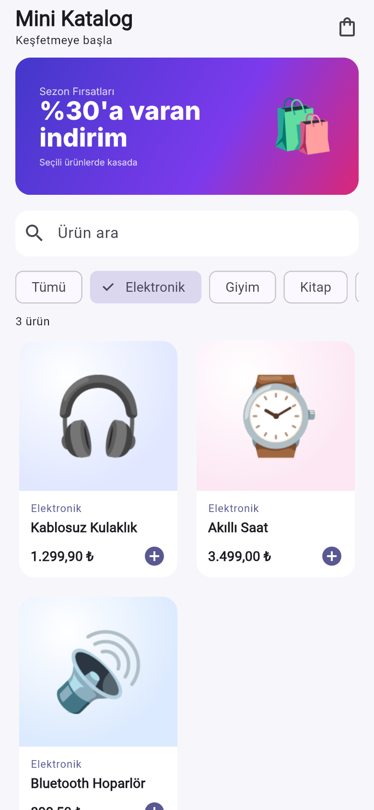
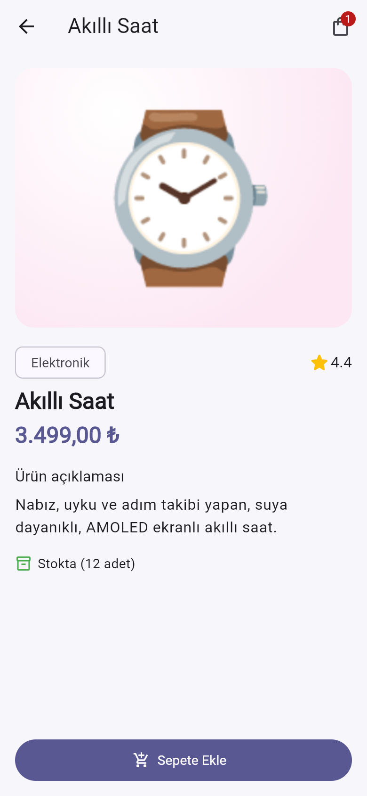
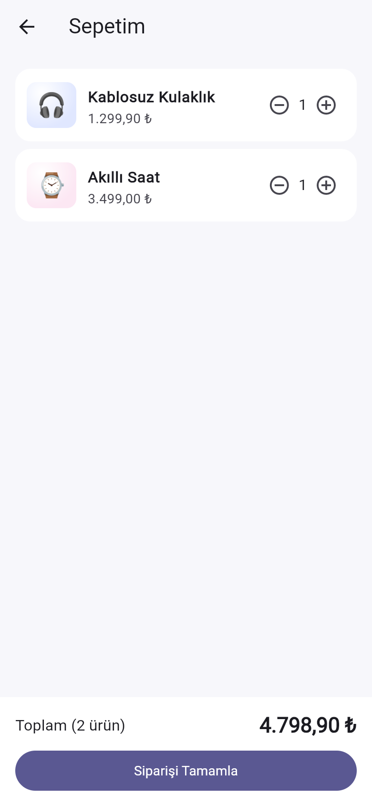
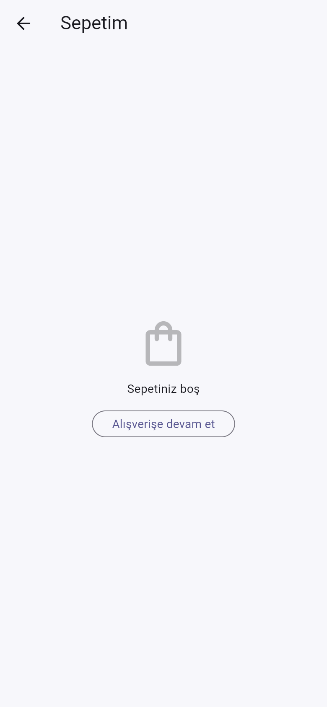

# Mini Katalog

Flutter ile geliştirilmiş; ürün listeleme, kategori filtreleme, arama, ürün detayı ve sepet
simülasyonu içeren basit ama profesyonel bir mobil katalog uygulaması.

> Mobil Uygulama Geliştirme; Android / iOS Eğitimi · Proje Çalışması · 2026

| Ana sayfa | Kategori filtresi | Ürün detayı | Sepet | Boş sepet |
|---|---|---|---|---|
|  |  |  |  |  |

## Özellikler

- **Ana sayfa:** kampanya banner'ı, ürün arama, kategori çipleri (`ListView.builder` + ChoiceChip)
- **Ürün listesi:** `GridView.builder` ile kart tabanlı tasarım, `Image.asset` görselleri
- **Navigasyon:** Named routes (`/`, `/detail`, `/cart`), `Navigator.pushNamed` + route `arguments`, detay sayfası için `MaterialPageRoute` (onGenerateRoute), `Navigator.pop` ile geri dönüş
- **Ürün detayı:** Hero animasyonu, puan, stok durumu, sepete ekleme
- **Sepet (simülasyon):** `ListView.builder` ile ürünler, adet artırma/azaltma, toplam tutar, boş sepet ekranı, AppBar'da rozetli sepet ikonu
- **Veri:** `assets/data/products.json` dosyasından okunan JSON, `Product.fromJson / toJson` model sınıfı
- **Tema:** Material 3, tek renkten (seed color) üretilen renk şeması

## Kullanılan Flutter Sürümü

- Geliştirme ve test: **Flutter 3.50.0 (stable) · Dart 3.14.0**
- Desteklenen en düşük sürüm: **Flutter 3.27 / Dart 3.6** (`pubspec.yaml` → `sdk: '>=3.6.0 <4.0.0'`)
- Ek paket yok, yalnızca `material.dart`

> Not: Flutter 3.47 ve sonrasında `package:flutter/material.dart` içe aktarması "deprecated"
> uyarısı verir (yerine `material_ui` paketi önerilir). Eğitim kapsamına uymak için
> `material.dart` korunmuş ve bu uyarı `analysis_options.yaml` dosyasında kapatılmıştır.

## Çalıştırma Adımları

```bash
# 1. Projeyi indirin
git clone https://github.com/BurakOsmanClk/mini-katalog.git
cd mini-katalog

# 2. Ortamı kontrol edin
flutter doctor

# 3. Bağımlılıkları kurun
flutter pub get

# 4. Emülatörü (Android Studio > Device Manager) veya fiziksel cihazı bağlayın, sonra:
flutter run
```

Testler: `flutter test` · Statik analiz: `flutter analyze`

## Klasör Yapısı

```
lib/
├── main.dart                     # MaterialApp, tema ve named route tanımları
├── models/product.dart           # Product modeli, fromJson / toJson, fiyat biçimi
├── data/product_repository.dart  # JSON'dan ürün okuma (API simülasyonu)
├── state/cart.dart               # Sepet durumu (ChangeNotifier)
├── theme/app_theme.dart          # Material 3 tema
├── screens/
│   ├── home_screen.dart          # Banner, arama, kategori, GridView.builder
│   ├── product_detail_screen.dart
│   └── cart_screen.dart
└── widgets/
    ├── product_card.dart         # Grid ürün kartı
    └── cart_button.dart          # Rozetli sepet ikonu
assets/
├── data/products.json            # 10 ürünlük örnek veri
└── images/                       # Banner ve ürün görselleri
test/widget_test.dart             # Model ve sepet birim testleri
```

## Veri Kaynağı Hakkında

Eğitim dokümanında örnek kaynak olarak `wantapi.com/products.php` verilmiştir. Bu proje,
yönergede belirtilen **"JSON simülasyonu"** yaklaşımıyla ve **ek paket kullanmadan**
çalışabilmesi için ürün verilerini `assets/data/products.json` dosyasından okur. Gerçek bir
API'ye geçmek için yalnızca `ProductRepository.fetchProducts()` metodunun değiştirilmesi
yeterlidir. Ürün verileri ve görseller eğitim/demo amaçlıdır.
